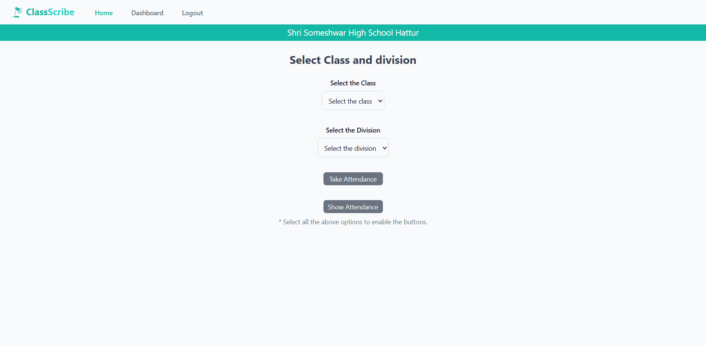
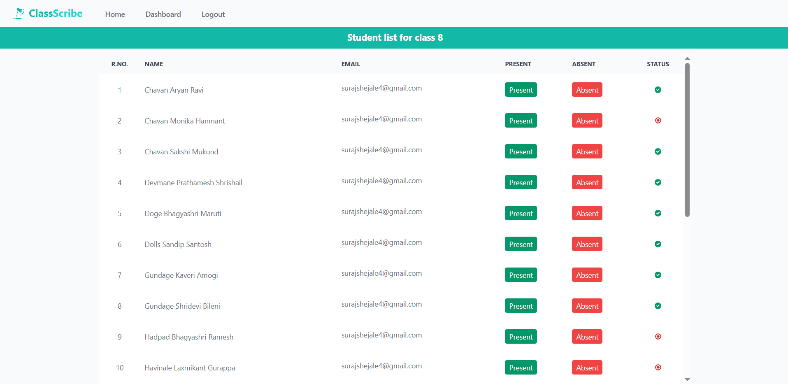
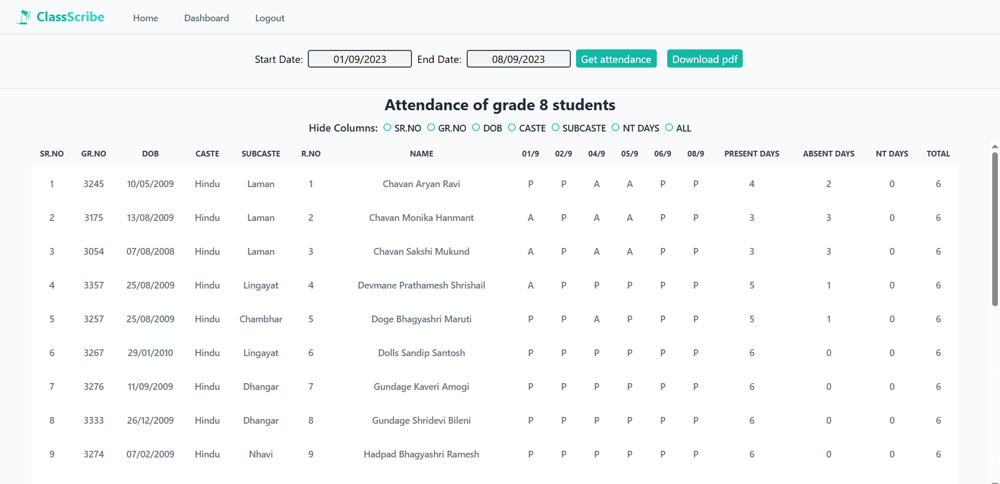
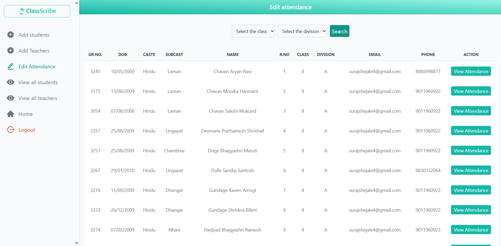
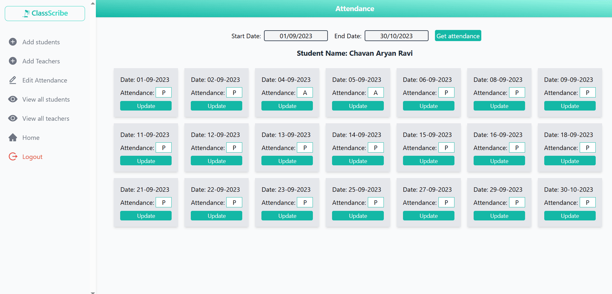
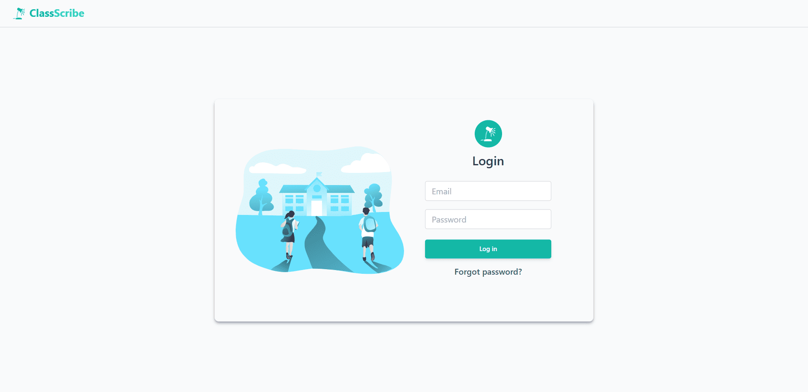

# Attendance Management System

A web-based attendance management system designed to simplify attendance tracking for teachers and keep parents informed about their children's attendance through SMS notifications.

## How It Works

- **Quick Attendance Tracking:** Teachers can mark students as present or absent without manually recording P/A entries in a register, saving time and effort.
- **SMS Notifications to Parents:** Parents receive SMS notifications about their child's attendance, helping them stay informed about whether their child has been marked present or absent.
- **Monthly Attendance Reports:** Teachers can view monthly attendance records to track student attendance and identify absences.
- **Better Parent Communication:** Timely notifications help parents stay informed and follow up when their child is absent unexpectedly.

## Screenshots

### Homepage

### Attendance Page

### View Attendance

### Admin Panel

### Edit Attendance

### Login Page

## Tech Stack

- Next.js
- React
- MongoDB
- JavaScript
