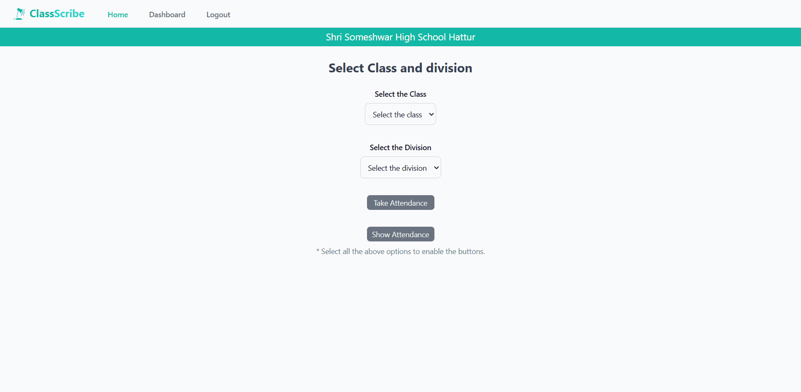
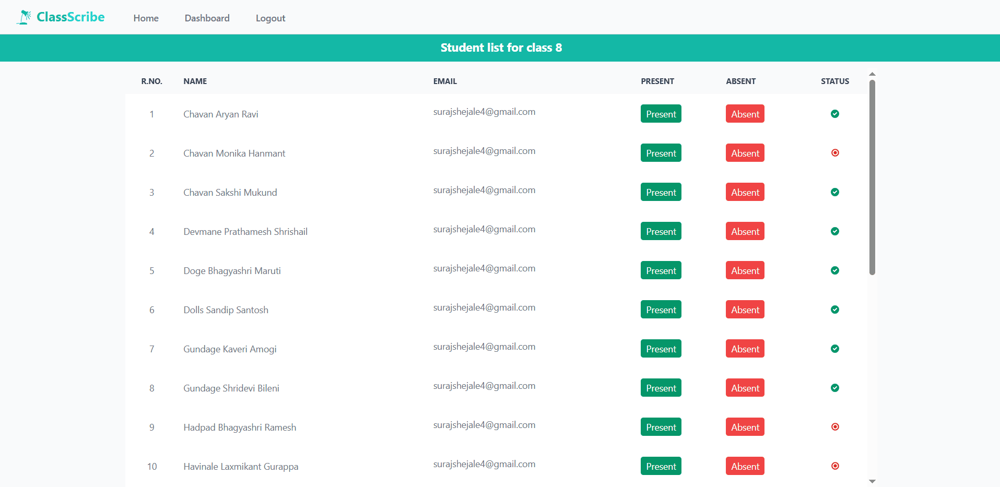
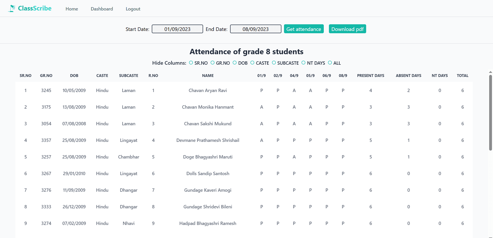
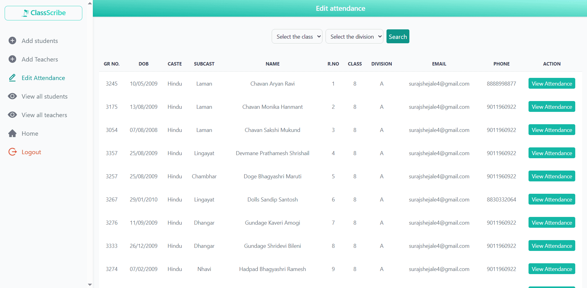
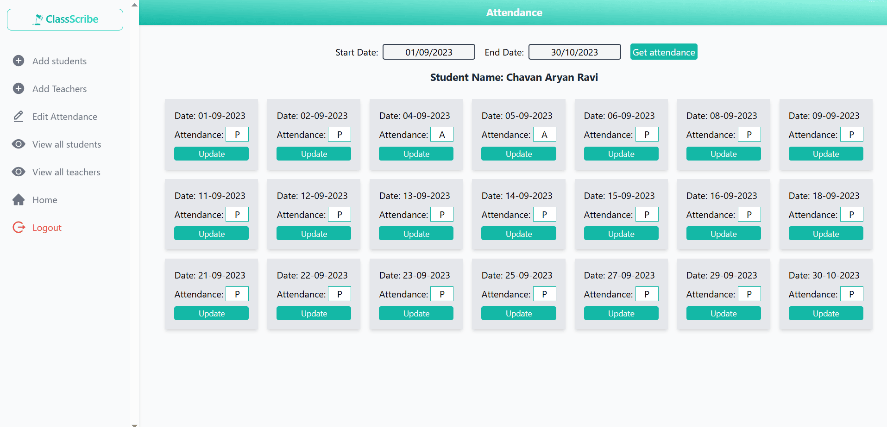
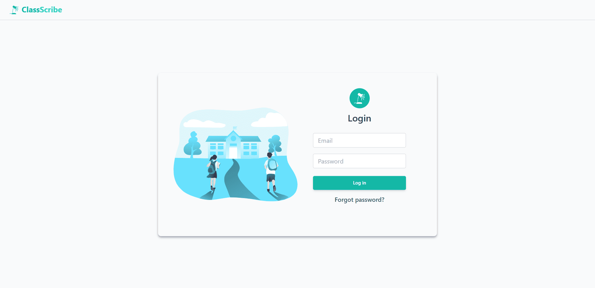

# ClassScribe - Attendance Management System

ClassScribe is a full-stack web application built with **Next.js 12 (Pages Router)**, **React 18**, **MongoDB (Mongoose)**, and **Tailwind CSS**. It is designed to streamline daily classroom attendance recording for teachers and automatically notify parents regarding their child's attendance status.

## Key Features

- **Rapid Attendance Recording:** Teachers can mark students present or absent with a single click; attendance is processed atomically with zero lock contention.
- **Automated Parent Notifications:** Sends immediate, bilingual email notifications (English & Marathi) to parents upon marking attendance via Nodemailer.
- **Comprehensive Monthly Attendance Matrix:** View and filter class-wise and division-wise attendance records across customizable date ranges, complete with printable and exportable PDF reports (`jsPDF` & `jspdf-autotable`).
- **Student & Faculty Management:** Secure administrative dashboard to manage student enrollments, teacher accounts, and role-based access permissions.
- **Hardened Security Architecture:**
  - One-way salted password hashing via **Bcrypt** (cost factor 12) with transparent legacy migration.
  - Role-Based Access Control (RBAC) enforced on the server for all administrative endpoints.
  - Exclusively **HttpOnly, SameSite=Lax, Secure** JWT cookie session authentication (zero `localStorage` credential exposure).
  - Stateless **HMAC-signed Double-Submit CSRF protection** with dedicated `CSRF_SECRET` key separation and self-healing auto-retry.
  - Sensitive data protection: Passwords strictly excluded from server-rendered HTML props (`__NEXT_DATA__`) and API responses.
  - Concurrency-safe, serverless-optimized MongoDB connection pooling with zero idle pool exhaustion.
  - Production HTTP security headers configured (`X-Frame-Options`, `X-Content-Type-Options`, `Referrer-Policy`, `X-XSS-Protection`).

## Tech Stack

- **Framework:** Next.js 12.3.1 (Pages Router)
- **Frontend:** React 18.2.0, Tailwind CSS 3
- **Database & ODM:** MongoDB with Mongoose 6.6.5
- **Authentication:** JWT (`jsonwebtoken`), Bcrypt (`bcryptjs`)
- **Email Service:** Nodemailer (SMTP)
- **Reporting:** jsPDF, jspdf-autotable

## Getting Started

### Prerequisites

- Node.js 16.x or 18.x
- MongoDB database instance (local or MongoDB Atlas)

### Installation

1. Clone the repository:
   ```bash
   git clone https://github.com/your-username/class-scribe.git
   cd class-scribe
   ```

2. Install dependencies:
   ```bash
   yarn install
   # or
   npm install
   ```

3. Configure environment variables in `.env.local`:
   ```env
   MONGO_URI=mongodb+srv://<username>:<password>@cluster0.mongodb.net/class-scribe?retryWrites=true&w=majority
   JWT_SECRET=your_super_secret_jwt_key
   CSRF_SECRET=your_super_secret_csrf_key
   NEXT_PUBLIC_HOST=http://localhost:3000
   EMAIL_ADDRESS=your_school_email@gmail.com
   EMAIL_PASSWORD=your_gmail_app_password
   ```

4. Run the development server:
   ```bash
   yarn dev
   # or
   npm run dev
   ```

5. Open [http://localhost:3000](http://localhost:3000) in your browser.

## Screenshots

### Homepage


### Attendance Page


### View Attendance


### Admin Panel


### Edit Attendance


### Login Page

